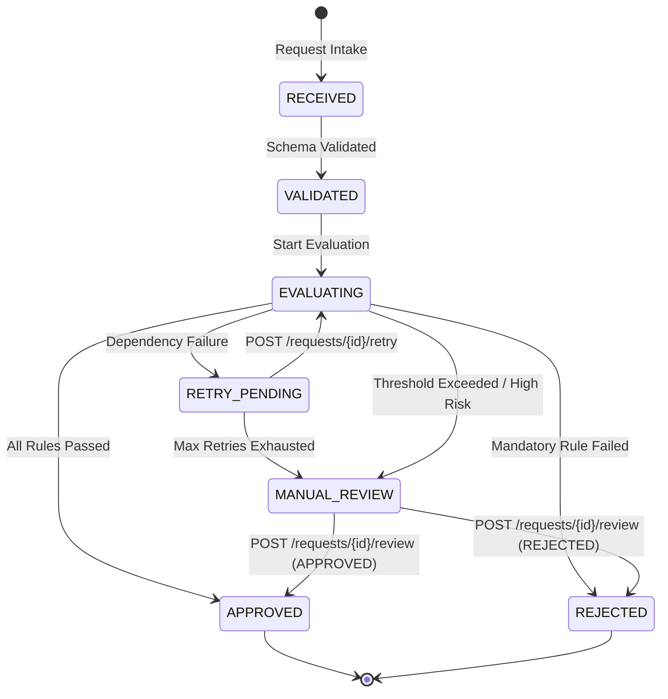

# Configurable Workflow Decision Platform - Architecture

## 1. System Overview & Core Components

The **Configurable Workflow Decision Platform** is a lightweight, high-reliability decision orchestration engine built with Spring Boot 3 and Java 17. The platform executes business decision workflows defined entirely in external YAML configurations, allowing business policies to be updated or introduced without modifying code or redeploying the application.

```
+-----------------------------------------------------------------------------------+
|                                 REST API Layer                                    |
|   WorkflowController                   AdminController                            |
+------------------------------------------+----------------------------------------+
                                           |
                                           v
+-----------------------------------------------------------------------------------+
|                              WorkflowEngine                                       |
|  - Idempotency & SHA-256 Deduplication   - Lifecycle State Machine                |
|  - Input Schema Validation               - Atomic @Transactional State Persistence|
|  - Dependency Orchestration              - Retry Counter & Boundary Enforcement   |
|  - Explainability & Audit Trail          - Human Review Resolution                |
+--------------+------------------+------------------+------------------+-----------+
               |                  |                  |                  |
               v                  v                  v                  v
       +---------------+  +---------------+  +---------------+  +----------------+
       |  RuleEngine   |  | ConfigLoader  |  | Verification  |  | Repositories    |
       |  (Decoupled   |  | (YAML Parser, |  | Service       |  | (JdbcTemplate   |
       |  Evaluation)  |  | Hot-Reload)   |  | (Simulated)   |  | SQL Durability) |
       +---------------+  +---------------+  +---------------+  +----------------+
```

### Component Responsibilities

1. **API Layer (`com.example.decision.api`)**:
   - `WorkflowController`: Exposes REST endpoints (`/requests`, `/requests/{id}`, `/requests/{id}/audit`, `/requests/{id}/explanation`, `/requests/{id}/retry`, `/requests/{id}/review`). Strictly converts HTTP requests/responses and delegates to `WorkflowEngine`. No business logic.
   - `AdminController`: Exposes administrative operations (`POST /admin/reload`) to hot-reload YAML configurations on runtime.
   - `GlobalExceptionHandler`: Centralized handler mapping domain exceptions to HTTP status codes (`422 Unprocessable Entity`, `409 Conflict`, `404 Not Found`, `400 Bad Request`, `500 Internal Server Error`).

2. **Workflow Orchestrator (`com.example.decision.workflow.WorkflowEngine`)**:
   - Enforces SHA-256 idempotency checking before intake.
   - Validates incoming payloads against the active workflow's `inputSchema`.
   - Drives atomic state transitions with synchronized history and audit log writes.
   - Invokes external dependencies and handles failure modes.
   - Delegates business rule evaluation to `RuleEngine`.
   - Evaluates rule outcomes to determine the final routing state (`APPROVED`, `REJECTED`, `MANUAL_REVIEW`, or `RETRY_PENDING`).
   - Generates human-readable explanations combining rule snapshots, reasons, and reviewer notes.

3. **Rule Engine (`com.example.decision.rules.RuleEngine`)**:
   - Zero coupling to HTTP, controllers, or database persistence.
   - Evaluates mandatory presence checks (`not_empty`, `present`), numeric and threshold comparisons (`>`, `>=`, `<`, `<=`, `==`, `!=`), set inclusion (`in`), and conditional branches (`when`).
   - Normalizes numerical operands to `BigDecimal` for precision.
   - Produces structured `RuleResult` instances recording the exact rule ID, stage, target field, expected value, actual value, pass/fail status, and diagnostic explanation.

4. **Configuration Loader (`com.example.decision.config.WorkflowConfigLoader`)**:
   - Parses YAML configs using Jackson's `YAMLFactory`.
   - Supports loading from both classpath (`classpath:workflows`) and dynamic filesystem directories.
   - Thread-safe storage in memory (`ConcurrentHashMap`), reloaded atomically via `POST /admin/reload`.

5. **External Dependency Simulator (`com.example.decision.dependency.SimulatedVerificationService`)**:
   - Simulates third-party dependencies (e.g., credit bureau, fraud prevention) with configurable failure behaviors: `OK`, `FAIL_ALWAYS`, and `FAIL_FIRST_N`.
   - Switchable at runtime via properties or programmatic setter for automated testing.

6. **Persistence Layer (`com.example.decision.store`)**:
   - `RequestRepository`, `HistoryRepository`, and `AuditRepository` utilize Spring's `JdbcTemplate` to execute direct, optimized SQL against H2.
   - Includes `TestFaultInjector` to simulate partial save failures and verify transaction rollbacks.

---

## 2. End-to-End Data Flow

```
Client              Controller         WorkflowEngine      RuleEngine       Database
  |                     |                    |                 |               |
  |--- POST /requests ->|                    |                 |               |
  |    {wf, key, body}  |--- processNewReq ->|                 |               |
  |                     |                    |-- SHA-256 check ----------------|
  |                     |                    |   (Idempotency: return/conflict)|
  |                     |                    |-- Validate schema --------------|
  |                     |                    |-- Save RECEIVED/VALIDATED ----->|
  |                     |                    |-- Call external dependency ---->|
  |                     |                    |-- evaluate(rules, payload) ---->|
  |                     |                    |<-- List<RuleResult> ------------|
  |                     |                    |-- Route outcome (APPROVED etc)->|
  |                     |                    |-- Atomic persist:               |
  |                     |                    |   Update Request, History, Audit|
  |                     |<-- RequestRecord --|                                 |
  |<-- HTTP 200/409/422-|                    |                                 |
```

---

## 3. Lifecycle State Machine



### State Definitions
- **`RECEIVED`**: Request accepted, verified for idempotency, and assigned a persistent ID.
- **`VALIDATED`**: Payload conforms to all schema rules (field presence and types).
- **`EVALUATING`**: Active processing of external dependencies and rule steps.
- **`APPROVED`**: All business rules and checks passed; decision finalized.
- **`REJECTED`**: One or more mandatory rejection rules triggered; decision finalized.
- **`MANUAL_REVIEW`**: High-value or edge-case request routed to human underwriter/claims adjuster, or max retries exhausted.
- **`RETRY_PENDING`**: External dependency encountered transient error; awaits retry trigger.
- **`FAILED`**: Malformed payload rejected before evaluation (recorded in audit log).

---

## 4. Configuration Model

Workflow behavior is defined strictly in YAML. A workflow definition consists of:

```yaml
name: loan_approval                      # Unique workflow identifier
version: "1.0.0"                         # Semantic version for auditing & reproducibility
maxRetries: 3                            # Max retries before escalating to MANUAL_REVIEW
dependencies:                            # External services required
  - verificationService

inputSchema:                             # Mandatory schema validation contract
  applicantId: { type: STRING, required: true }
  creditScore: { type: INTEGER, required: true }
  loanAmount:  { type: DECIMAL, required: true }

stages:                                  # Logical grouping for explainability
  - id: ELIGIBILITY
  - id: RISK_ASSESSMENT

routing:
  defaultOutcome: APPROVED
  failureOutcome: REJECTED

ruleSteps:                               # Ordered evaluation pipeline
  - id: rule-min-credit-score
    stage: RISK_ASSESSMENT
    field: creditScore
    operator: ">="                       # >, >=, <, <=, ==, !=, in, not_empty
    value: 600
    onFailure: REJECT                   # Routing action: REJECT | MANUAL_REVIEW
    failureReason: "Credit score below mandatory cutoff"

  - id: rule-self-employed-check
    stage: RISK_ASSESSMENT
    field: creditScore
    operator: ">="
    value: 720
    when:                                # Conditional branching
      field: employmentStatus
      operator: "=="
      value: "SELF_EMPLOYED"
    onFailure: MANUAL_REVIEW
    failureReason: "Self-employed requires 720+ credit or manual underwriter review"
```

### Explainability Snapshotting
When a request is evaluated, `WorkflowEngine` persists:
1. `config_version`: Version string of the active configuration.
2. `rules_snapshot`: A complete JSON array of every evaluated rule step with its input value, operator, threshold, pass/fail result, and reason.

Even if rules change tomorrow in `v2.0.0`, past decisions queryable via `GET /requests/{id}/explanation` remain 100% explainable and reproducible against the original rules under which they were decided.

---

## 5. Idempotency and Consistency Approach

### Idempotency Guarantee
- Every request accepts a caller-supplied `idempotencyKey`.
- A database-level `UNIQUE` constraint on `requests(idempotency_key)` guarantees that concurrent identical submissions cannot duplicate records.
- Incoming payloads are canonicalized (keys sorted alphabetically) and hashed with `SHA-256`:
  - **Identical Key + Identical Payload Hash**: The engine recognizes a safe duplicate and immediately returns the previously saved `RequestRecord`. External dependencies and rule evaluation are **not** re-invoked.
  - **Identical Key + Different Payload Hash**: The engine throws `IdempotencyConflictException`, returning `HTTP 409 Conflict`.

### ACID Consistency & Rollback
- State updates, history table entries (`request_state_history`), and audit trail entries (`audit_log`) occur within a single Spring `@Transactional` method.
- If any operation fails (such as database disconnection, disk failure, or simulated fault injection), the entire transaction rolls back completely, preventing half-saved requests or missing audit entries.

---

## 6. Architectural Trade-offs

| Decision | Choice | Alternatives | Rationale & Trade-off |
| :--- | :--- | :--- | :--- |
| **Storage Engine** | H2 (File Mode) | SQLite, Postgres, In-Memory H2 | In file mode (`jdbc:h2:file:./data/decisiondb`), data survives process restarts with zero external infrastructure setup required. Zero DevOps overhead for development and evaluation. |
| **Execution Model** | Synchronous | Asynchronous Workers (Kafka/RabbitMQ) | Eliminates message broker complexity and polling latency. REST clients receive decisions immediately while retaining full auditability. Async scaling is handled via worker queues when required. |
| **Configuration Format** | YAML | JSON, Database-driven rules, Drools | Clean, human-readable, supports comments, widely understood by developers and domain experts. Version controllable in Git alongside code. |
| **Persistence Framework** | `JdbcTemplate` | Spring Data JPA / Hibernate | Absolute control over SQL queries, explicit transaction boundaries, no hidden N+1 queries, zero dirty-checking magic, and instantaneous startup times without ORM overhead. |

---

## 7. Assumptions

1. **Idempotency Scope**: Idempotency keys are unique per business transaction and provided by the upstream client.
2. **External Dependencies**: External services are abstracted through a standardized Java interface (`verify(workflow, requestId, payload)`). Transient failures trigger retries; permanent failures escalate.
3. **Configuration Storage**: Configs reside on local/container storage accessible to the application nodes. Hot reload (`POST /admin/reload`) reads from this directory without requiring a process restart.

---

## 8. Scaling Considerations for Production

To transition this platform from a single-node deployment to an enterprise-grade, high-throughput distributed system:

1. **PostgreSQL / Distributed SQL**:
   - Replace file-based H2 with PostgreSQL (or CockroachDB/YugabyteDB).
   - Leverage `JSONB` for `payload` and `rules_snapshot` columns with GIN indexing for flexible querying.

2. **Database Partitioning & Indexing**:
   - Partition `requests`, `request_state_history`, and `audit_log` tables by `workflow` and date range (e.g., monthly partitions).
   - Enforce global unique indexing on `idempotency_key` with partition pruning.

3. **Asynchronous Queue-Based Workers**:
   - For high-volume or slow external dependencies, ingest requests onto a durable queue (Apache Kafka, AWS SQS, or RabbitMQ).
   - Separate the API intake tier (which validates schema, generates ID, and enqueues) from background decision worker pools.

4. **Distributed Config Caching**:
   - Cache loaded `WorkflowConfig` instances across cluster nodes using Redis or distributed caches.
   - Use Redis Pub/Sub or etcd watch keys so calling `POST /admin/reload` on one node invalidates and reloads configs across all nodes instantaneously.

5. **Resilience & Dependency Protection**:
   - Implement Resilience4j Circuit Breakers, Bulkheads, and Rate Limiters around external verification calls to avoid cascading failures.
   - Employ exponential backoff with jitter on retry schedules.

6. **Transactional Outbox Pattern**:
   - Write decision events to an `outbox` table in the same transaction as state changes. A Debezium CDC (Change Data Capture) connector or lightweight polling worker streams these events to downstream consumers without dual-write inconsistency.

7. **Horizontal Scaling of Stateless API**:
   - The application controllers and engines are completely stateless. Scale horizontal API instances behind an ALB/Nginx load balancer with health checks.

